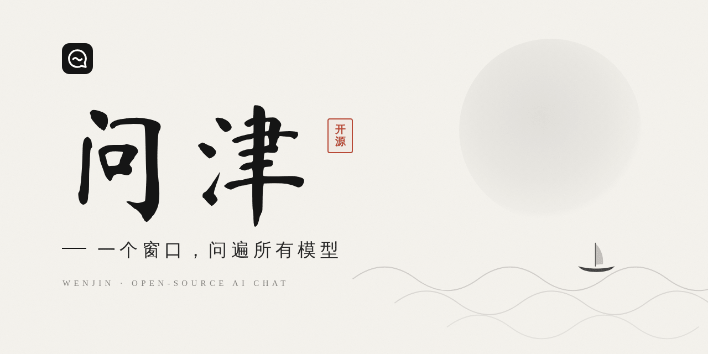
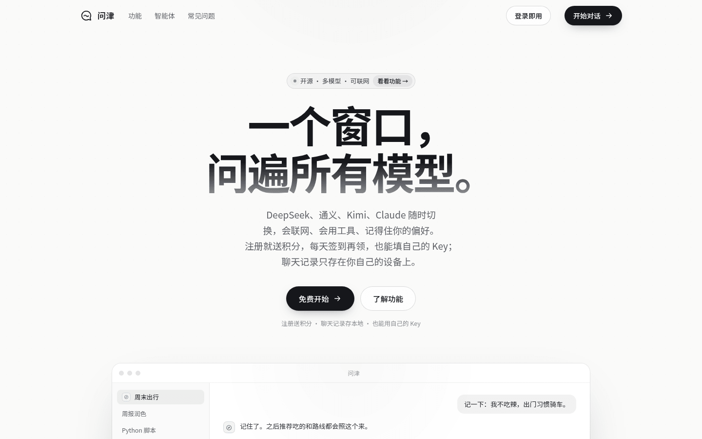
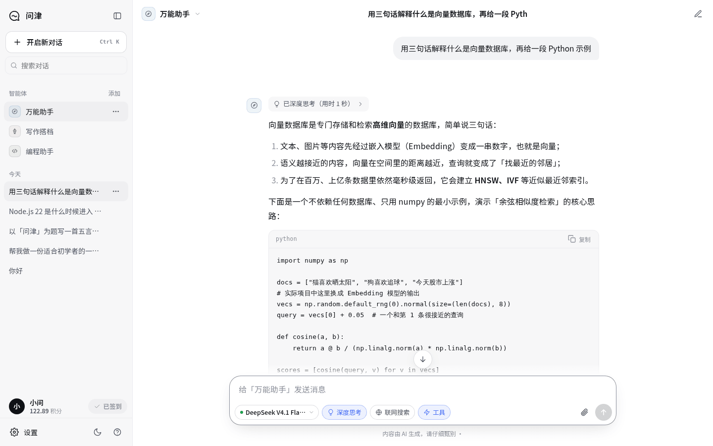
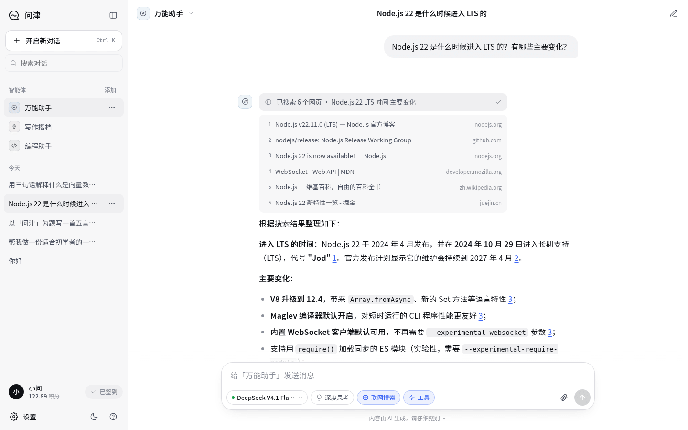
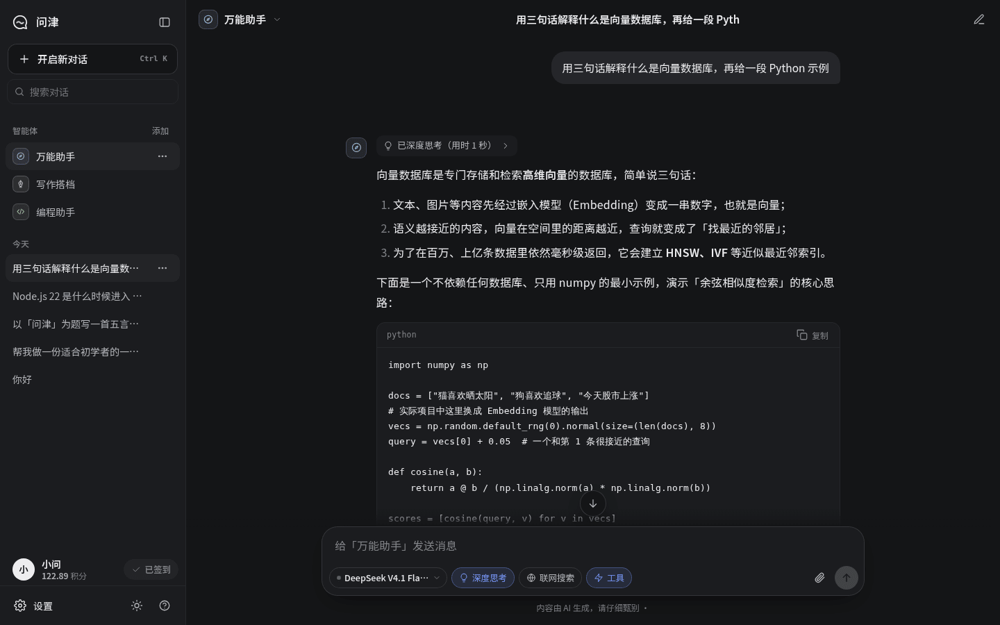
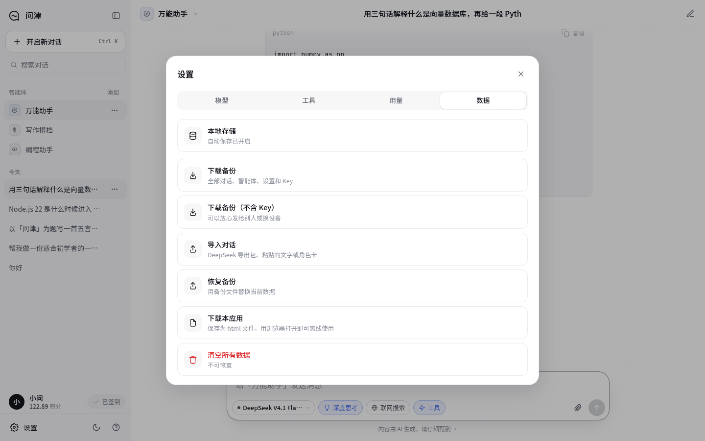
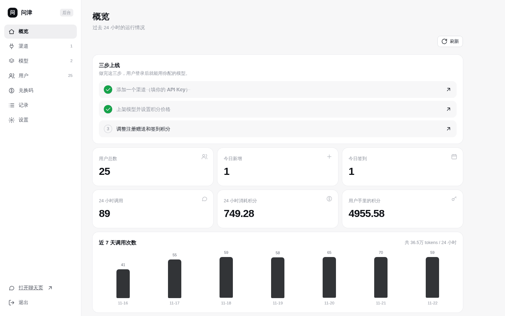
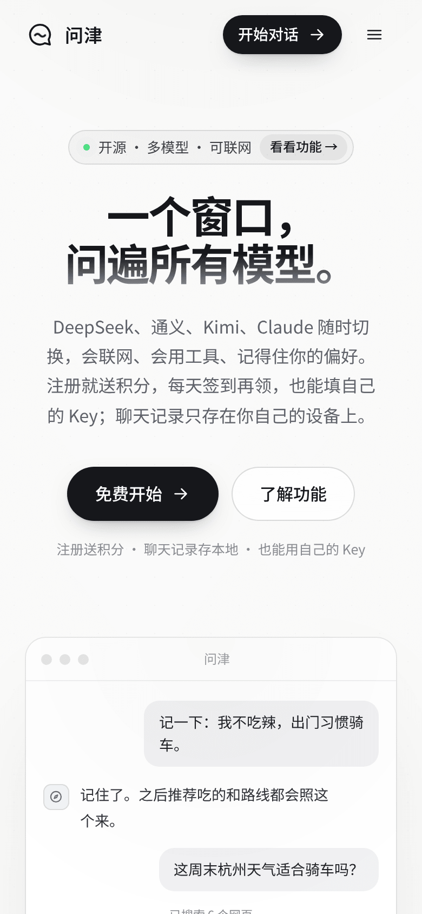
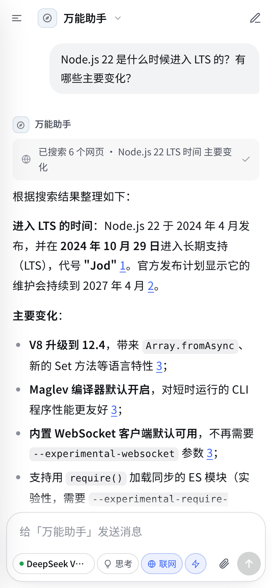

<div align="center">



<h1>Wenjin 问津</h1>

<p><b>One window, every model.</b><br>
A self-hostable, open-source AI chat website: multi-model channels, streaming, web search, a credits system and an admin panel — with <b>zero npm dependencies</b>. One <code>node server.js</code> and you are running.</p>

<p>
<a href="LICENSE"></a>
<a href="https://nodejs.org/"></a>
<a href="#docker"></a>


</p>

<p><a href="README.md">简体中文</a> · <b>English</b></p>

<p>
<a href="#features">Features</a> ·
<a href="#quick-start">Quick start</a> ·
<a href="#deploy">Deployment</a> ·
<a href="#config">Configuration</a> ·
<a href="#faq">FAQ</a> ·
<a href="#security">Security</a>
</p>

</div>

---

The name *Wenjin* (问津) comes from the *Analects* — "to ask where the ferry crossing is", i.e. to ask the way. It is an AI chat site you host yourself. The admin connects any OpenAI-compatible model provider (DeepSeek, Qwen, Kimi, GLM, SiliconFlow, OpenRouter, …) in the admin panel; users sign up and chat with credits, or skip sign-up entirely and use their own API key in the browser. **Conversations stay in each user's browser** — the server only relays requests and records usage.

> The UI is in Simplified Chinese.

## 📸 Screenshots

<table>
  <tr>
    <td width="50%"><p align="center"><sub>Landing page · desktop</sub></p></td>
    <td width="50%"><p align="center"><sub>Chat: reasoning, Markdown, code blocks, tables (demo data)</sub></p></td>
  </tr>
  <tr>
    <td><p align="center"><sub>Web search: "searched N pages" sources panel with inline citations (demo data)</sub></p></td>
    <td><p align="center"><sub>Dark mode (demo data)</sub></p></td>
  </tr>
  <tr>
    <td><p align="center"><sub>Settings → Data: backup / restore, import DeepSeek exports and character cards</sub></p></td>
    <td><p align="center"><sub>Admin dashboard: users, calls, credits spent, 7-day trend (demo data)</sub></p></td>
  </tr>
  <tr>
    <td align="center"><p align="center"><sub>Landing page · mobile</sub></p></td>
    <td align="center"><p align="center"><sub>Chat on a phone, installable to the home screen (demo data)</sub></p></td>
  </tr>
</table>

> Screenshots were taken on a local instance. In shots marked "demo data", model replies were streamed by a local mock OpenAI-compatible endpoint, search results came from a mock SearXNG endpoint, and admin statistics are made-up users and calls. None of it is real model output or real user data.

<a name="features"></a>

## ✨ Features

### Chat

| | |
| --- | --- |
| 🔌 **Multi-model channels** | Connect any **OpenAI-compatible API** (`/v1/chat/completions`), plus a "DeepSeek official" type with a thinking-mode switch; switch models per chat |
| ⚡ **Streaming** | Server-side SSE relayed chunk by chunk (Nagle off, `X-Accel-Buffering: no`, 15 s heartbeat) with an adaptive typewriter effect |
| 🧠 **Reasoning** | Shows `reasoning_content` in a collapsible block with thinking time |
| 🌐 **Web search** | Self-hosted [SearXNG](https://github.com/searxng/searxng) gives **every model** web access; answers carry a "searched N pages" sources panel and `[n](url)` inline citations; falls back to search-then-answer for models without tool calling |
| 🛠️ **Tools (agent)** | Read web pages, run JavaScript, create files, long-term memory, per-persona knowledge base, custom HTTP tools |
| 🔍 **Conversation search** | Search all past chats by title and content |
| ✏️ **Edit & resend** | Edit any user message and resend; regenerate, copy, read aloud |
| 🗜️ **Auto-compression** | Near the context limit, older turns are summarised into an editable "conversation summary"; the original text is kept |
| 🎭 **Personas** | Built-in templates (general assistant, writing partner, coding assistant, …) with avatar, personality, relationship, opening line and banned words — the same persona across models |
| 📥 **Import** | DeepSeek official export (zip / json), pasted chat text, SillyTavern character cards (PNG / JSON) |
| 💾 **Own your data** | Chats live in the browser's IndexedDB; backup / restore, export to Markdown, download an offline single-file build |
| 📱 **PWA** | Web App Manifest and icons — "Add to Home Screen" on phones, opens full-screen; light / dark theme follows the system |

### Accounts & operations

| | |
| --- | --- |
| 👤 **Accounts** | Log in with username or email, password reset, self-hosted SVG captcha (no third-party captcha service) |
| ✉️ **Email verification** | With SMTP configured, sign-up and password reset use a 6-digit email code (zero-dependency SMTP client, port 465 SSL or STARTTLS) |
| 🪙 **Credits** | Sign-up bonus, daily check-in with streak bonus, invite codes that reward both sides, batch redeem codes; per-token billing with the cost shown under each reply |
| 🧭 **Admin panel** | Overview stats, channels (one-click test), auto-detect and list models from a channel, model pricing, users, redeem codes, site settings, usage logs |

### Security

| | |
| --- | --- |
| 🔑 **Keys never leave the server** | Channel API keys are never returned by any endpoint and are scrubbed from upstream error messages |
| 🛡️ **SSRF guard** | The page reader validates every redirect hop and blocks private, loopback and IPv4-mapped addresses, with port, size and time limits |
| 🚦 **Rate limits** | Per-IP / per-account limits on login, sign-up, codes, chat, web tools and redeem; captcha required after 3 failed logins |
| 🌍 **Real client IP** | `TRUST_PROXY` resolves the client IP correctly behind reverse proxies or Cloudflare |

## 🧱 Tech stack

- **Backend**: plain Node.js standard library (`http`, `crypto`, `net`, `tls`, …). `package.json` has **no dependencies** — no `npm install`. Requires Node.js ≥ 18 (global `fetch`); 22 LTS recommended (the Docker image uses `node:22-alpine`).
- **Frontend**: vanilla HTML / CSS / JavaScript in single files — `public/index.html` (chat) and `public/admin.html` (admin). No build step.
- **Storage**: one JSON file on the server, `data/db.json` (atomic writes); chats in the browser's IndexedDB.
- **Search**: optional self-hosted SearXNG (`docker compose --profile search`).

```
server.js          HTTP server, accounts / credits / admin API, model relay (SSE)
websearch.js       SearXNG client + SSRF-guarded page reader
mailcap.js         zero-dependency SMTP + SVG captcha
public/            frontend (index.html chat, admin.html admin, PWA manifest and icons)
db.example.json    sample database (one disabled DeepSeek channel, no users, no keys)
searxng/           sample SearXNG config
docs/              banner and screenshots used by the README
data/              runtime data (git-ignored)
```

<a name="quick-start"></a>

## 🚀 Quick start

All you need is Node.js 18 or newer:

```bash
git clone https://github.com/jihemanyouzhe-boy/wenjin-chat.git && cd wenjin-chat
cp .env.example .env          # edit .env and set at least ADMIN_PASSWORD (8+ characters)
node server.js                # or: npm start
```

- Chat: <http://localhost:3000>
- Admin: <http://localhost:3000/admin>

The first start creates an empty database at `data/db.json`. You can also start from the sample database (a **disabled** DeepSeek channel and two sample models, no keys) and then add your key in the admin panel:

```bash
mkdir -p data && cp db.example.json data/db.json
```

<a name="deploy"></a>

## 📦 Deployment

The examples use the domain `chat.example.com` and the install directory `/opt/wenjin-chat`; replace them with your own.

### (a) Plain Node + systemd

```bash
# 1. Install Node.js 22 (NodeSource, nvm or your distro's packages)
node -v    # must be >= 18

# 2. Get the code and create a service user
sudo git clone https://github.com/jihemanyouzhe-boy/wenjin-chat.git /opt/wenjin-chat
sudo useradd --system --home /opt/wenjin-chat --shell /usr/sbin/nologin wenjin
cd /opt/wenjin-chat
sudo cp .env.example .env
sudo nano .env      # set ADMIN_PASSWORD; behind a reverse proxy also set HOST=127.0.0.1 and TRUST_PROXY=1
sudo mkdir -p data && sudo chown -R wenjin:wenjin data
sudo chown wenjin:wenjin .env && sudo chmod 600 .env
```

`server.js` reads the `.env` next to it on start (existing environment variables win), so the unit file needs no `EnvironmentFile`.

`/etc/systemd/system/wenjin.service`:

```ini
[Unit]
Description=Wenjin AI chat
After=network-online.target
Wants=network-online.target

[Service]
Type=simple
User=wenjin
Group=wenjin
WorkingDirectory=/opt/wenjin-chat
ExecStart=/usr/bin/node /opt/wenjin-chat/server.js
Restart=on-failure
RestartSec=3
# On SIGTERM the database is flushed to disk before exit
KillSignal=SIGTERM
TimeoutStopSec=10

# Hardening (optional)
NoNewPrivileges=true
PrivateTmp=true
ProtectSystem=strict
ProtectHome=true
ReadWritePaths=/opt/wenjin-chat/data

[Install]
WantedBy=multi-user.target
```

```bash
sudo systemctl daemon-reload
sudo systemctl enable --now wenjin
journalctl -u wenjin -f
```

> If `which node` is not `/usr/bin/node` (e.g. installed with nvm), change `ExecStart` accordingly.

<a name="docker"></a>

### (b) Docker / docker compose

The repo ships a `Dockerfile` (`node:22-alpine`, runs as the non-root `node` user, with a health check) and a `docker-compose.yml`:

```bash
cp .env.example .env
# edit .env: set ADMIN_PASSWORD; for web search also add SEARXNG_SECRET=<output of: openssl rand -hex 32>
mkdir -p data && sudo chown -R 1000:1000 data   # the container's node user is uid 1000

docker compose up -d                       # chat service only
docker compose --profile search up -d      # plus a private SearXNG for web search
docker compose logs -f wenjin
```

- Data lives in `./data` on the host (mounted at `/app/data`).
- With the `search` profile, SearXNG is only reachable on the internal Docker network (no published port); the chat service reaches it at `http://searxng:8080`. That address comes from `SEARXNG_URL` in the compose file (override with `SEARXNG_URL_DOCKER`) and is written on **first database creation**.
- SearXNG is configured in `searxng/settings.yml`; keep `search.formats: [html, json]`. The file also notes which engines tend to work from mainland China.
- Behind Nginx / Caddy, change the port mapping to `"127.0.0.1:3000:3000"` and set `TRUST_PROXY=1` in `.env`.

### (c) Reverse proxy

Replies are **streamed over SSE**, so the proxy must not buffer responses — otherwise the answer arrives all at once after a long pause. Long chats send the full history (the server accepts up to 40 MB), so raise the request body limit too.

**Nginx** (`/etc/nginx/conf.d/wenjin.conf`):

```nginx
server {
    listen 80;
    server_name chat.example.com;

    client_max_body_size 50m;            # long conversations make big requests

    location / {
        proxy_pass http://127.0.0.1:3000;
        proxy_http_version 1.1;
        proxy_set_header Host $host;
        proxy_set_header X-Real-IP $remote_addr;
        proxy_set_header X-Forwarded-For $proxy_add_x_forwarded_for;
        proxy_set_header X-Forwarded-Proto $scheme;
        proxy_set_header Connection "";

        # required for streaming
        proxy_buffering off;
        proxy_cache off;
        gzip off;
        proxy_read_timeout 600s;
        proxy_send_timeout 600s;
    }
}
```

**Caddy** (`/etc/caddy/Caddyfile`, automatic HTTPS):

```caddy
chat.example.com {
    request_body {
        max_size 50MB
    }
    reverse_proxy 127.0.0.1:3000 {
        flush_interval -1        # flush every chunk immediately (SSE)
    }
}
```

Either way, set `HOST=127.0.0.1` (or map Docker to `127.0.0.1:3000`) and `TRUST_PROXY=1` in `.env`, then restart.

### (d) Cloudflare Tunnel (no public IP / no open ports)

```bash
# 1. Install cloudflared (see Cloudflare's docs), log in and authorise your domain
cloudflared tunnel login

# 2. Create a tunnel and note the Tunnel ID it prints
cloudflared tunnel create wenjin

# 3. Point a hostname at the tunnel
cloudflared tunnel route dns wenjin chat.example.com
```

`~/.cloudflared/config.yml`:

```yaml
tunnel: <TUNNEL_ID>
credentials-file: /home/<user>/.cloudflared/<TUNNEL_ID>.json

ingress:
  - hostname: chat.example.com
    service: http://127.0.0.1:3000
  - service: http_status:404
```

```bash
cloudflared tunnel run wenjin                 # try it in the foreground
sudo cloudflared service install              # then install it as a service
```

Set `HOST=127.0.0.1` in `.env`. Because the site is only reachable through Cloudflare, you can set `TRUST_PROXY=cloudflare` (uses `CF-Connecting-IP`). The same setup can also be done as a remotely-managed tunnel in the Cloudflare Zero Trust dashboard.

### (e) HTTPS

- **Caddy**: just use your domain — certificates are issued and renewed automatically.
- **Nginx**: use certbot:
  ```bash
  sudo apt install certbot python3-certbot-nginx
  sudo certbot --nginx -d chat.example.com
  ```
- **Cloudflare Tunnel**: HTTPS is terminated at Cloudflare's edge; no certificate needed on the origin.

"Add to Home Screen" and browser features such as the clipboard require HTTPS (except on `localhost`).

### (f) After the first start

**1. Admin account**

- Recommended: set `ADMIN_PASSWORD` (8+ characters) in `.env` before starting. It **only takes effect while no admin password exists**; change it later under Admin → Settings → 安全 (security).
- If you skip it, whoever opens `/admin` first gets to set the password — do it right away.

**2. Add a channel (DeepSeek example)**

1. Admin → **Channels** → Add channel:
   - Name: `DeepSeek`
   - Type: `DeepSeek 官方` (DeepSeek official, supports the thinking switch); use `OpenAI 兼容` (OpenAI-compatible) for other providers
   - Base URL: `https://api.deepseek.com` (OpenAI-compatible providers usually end at `/v1`, e.g. `https://api.openai.com/v1`; a pasted `/chat/completions`, `/responses` or `/models` suffix is stripped automatically)
   - API key: a key from your provider's console
2. Click **Test** on the channel to check connectivity.
3. Admin → **Models** → **Add models**: models are auto-detected from the channel; tick the ones you want and publish them. Then adjust the display name, upstream model name (check your provider's docs), context length, input / output price (credits per 1K tokens) and whether it supports reasoning.

**3. Email (SMTP, optional)**

Either:

- set `SMTP_HOST`, `SMTP_PORT`, `SMTP_USER`, `SMTP_PASS`, `SMTP_FROM_NAME` in `.env` — when both `SMTP_USER` and `SMTP_PASS` are set they take precedence and the admin email settings become read-only; or
- fill in Admin → Settings → 邮箱验证 (email verification) and send a test email.

Port `465` uses SSL; any other port uses STARTTLS. Providers such as QQ Mail and 163 require an SMTP *authorisation code*, not your login password. The "注册需要邮箱验证码" (require email code) switch (on by default) only takes effect once mail is configured; without mail, sign-up uses the image captcha.

**4. Enable web search**

1. Run SearXNG: with Docker just use `docker compose --profile search up -d`; for a bare-metal install you can run a local-only instance:
   ```bash
   docker run -d --name wenjin-searxng --restart unless-stopped \
     -p 127.0.0.1:8890:8080 \
     -v "$(pwd)/searxng:/etc/searxng" \
     -e SEARXNG_SECRET="$(openssl rand -hex 32)" \
     searxng/searxng:latest
   ```
2. Admin → **Settings → Web search**: switch it on, set the address to `http://searxng:8080` (compose) or `http://127.0.0.1:8890` (the instance above), and run the test search.
3. Signed-in users turn on "联网搜索" (web search) under the input box.

<a name="config"></a>

## ⚙️ Configuration

Everything comes from environment variables or a `.env` file in the project directory (existing environment variables win). See [`.env.example`](.env.example).

| Variable | Default | Description |
| --- | --- | --- |
| `PORT` | `3000` | Listening port |
| `HOST` | `0.0.0.0` | Listening address; use `127.0.0.1` behind a local reverse proxy |
| `DATA_DIR` | `./data` | Data directory (relative to `server.js`); `db.json` holds users, sessions and channel keys |
| `SITE_NAME` | `问津` | Site name, used only when the database is first created (edit later in the admin); also the fallback sender name |
| `ADMIN_PASSWORD` | empty | Admin password (8+ characters recommended), **only applied while no admin exists**. Strongly recommended |
| `TRUST_PROXY` | `0` | `0` direct, use the TCP peer; `1` one reverse proxy in front, use the last `X-Forwarded-For` entry; `cloudflare` prefer `CF-Connecting-IP` (only when reachable solely via Cloudflare) |
| `SEARXNG_URL` | `http://127.0.0.1:8890` | SearXNG address (legacy name `SEARCH_URL` also accepted); default only on first database creation, change later in Admin → Settings → Web search |
| `SMTP_HOST` | `smtp.qq.com` | SMTP server |
| `SMTP_PORT` | `465` | `465` = SSL, anything else = STARTTLS |
| `SMTP_USER` | empty | Sender address |
| `SMTP_PASS` | empty | Password / authorisation code; with `SMTP_USER` it overrides the admin settings |
| `SMTP_FROM_NAME` | site name | Sender display name |
| `CAPTCHA_TEST` | off | Local automated testing only: when `1`, the captcha endpoint returns the answer. **Never enable in production** |

Used only by `docker-compose.yml`:

| Variable | Default | Description |
| --- | --- | --- |
| `SEARXNG_SECRET` | `change-me-to-a-random-string` | SearXNG secret — set it to the output of `openssl rand -hex 32` |
| `SEARXNG_URL_DOCKER` | `http://searxng:8080` | Address the chat container uses for SearXNG (passed as its `SEARXNG_URL`) |

> Site name, notice, sign-up switch, email verification, credit rules, concurrency limit and web-search settings are edited in Admin → Settings, stored in `db.json`, and need no restart.

## 💾 Data & backup

| Where | What |
| --- | --- |
| Server `data/db.json` | Site settings, channels and **API keys**, models, users (scrypt password hashes), sessions, redeem codes, usage logs |
| User's browser (IndexedDB) | Conversations, personas, long-term memory, knowledge base, the user's own keys |

The server never stores chat content. To back up, copy `data/db.json` (writes are atomic renames, so copying is safe):

```bash
# daily at 03:00, keep 14 days (crontab -e)
0 3 * * * cp /opt/wenjin-chat/data/db.json /var/backups/wenjin-$(date +\%F).json && find /var/backups -name 'wenjin-*.json' -mtime +14 -delete
```

Keep backups readable only by you (they contain channel keys). Users back up their own chats via Settings → Data → download backup.

## ⬆️ Upgrading

```bash
# bare metal
cd /opt/wenjin-chat
cp data/db.json data/db.json.bak-$(date +%F)    # back up first
git pull
sudo systemctl restart wenjin

# Docker
git pull
docker compose up -d --build                    # add --profile search if you use search
```

The database is forward-compatible: new settings are filled in with defaults on start.

<a name="faq"></a>

## ❓ FAQ

<details>
<summary><b>Replies appear all at once instead of streaming</b></summary>

Your reverse proxy is buffering. Add `proxy_buffering off;` (and turn off `gzip` for that location) in Nginx, or `flush_interval -1` in Caddy. If a CDN sits in between, make sure it does not buffer or compress `text/event-stream`. The server already sends `X-Accel-Buffering: no` and a heartbeat every 15 seconds.
</details>

<details>
<summary><b>"联网搜索需要先登录账号" — web search says I need to sign in</b></summary>

By design: the search and page-reader endpoints are only available to signed-in users and are rate-limited per account and IP, so the site cannot be abused as an anonymous search / scraping proxy. Visitors who only use their own key without signing in cannot use web search. If it still fails after signing in, run the test search in Admin → Settings → Web search and check the SearXNG address and that `json` is enabled in `settings.yml`.
</details>

<details>
<summary><b>Channel test fails, or the provider only supports <code>/responses</code></b></summary>

Wenjin calls the standard `POST {base}/chat/completions`. The base URL should end at `/v1` (`https://api.deepseek.com` for DeepSeek); pasted `/chat/completions`, `/responses` or `/models` suffixes are stripped. Providers that only expose the Responses API, or only allow specific official clients / coding tools, cannot be connected directly — use a provider or gateway that offers Chat Completions.
</details>

<details>
<summary><b>413 errors / long conversations fail to send</b></summary>

Your proxy's request body limit is too small. Set `client_max_body_size 50m;` in Nginx or `request_body { max_size 50MB }` in Caddy.
</details>

<details>
<summary><b>Docker: EACCES, cannot write to <code>/app/data</code></b></summary>

The container runs as the `node` user (uid 1000). Run `sudo chown -R 1000:1000 data` and restart.
</details>

<details>
<summary><b>Rate limits hit everyone / every IP in the logs is 127.0.0.1</b></summary>

You are behind a proxy without `TRUST_PROXY`. Set it to `1` (Nginx / Caddy) or `cloudflare` (Cloudflare-only access) and restart. Conversely, keep it `0` when serving directly, or clients can spoof their IP.
</details>

<details>
<summary><b>Forgot the admin password</b></summary>

Stop the service, edit `data/db.json` and set `"admin"` to `null`, set a new `ADMIN_PASSWORD` in `.env`, then start the service.
</details>

<details>
<summary><b>Verification emails never arrive</b></summary>

Send a test email from Admin → Settings → 邮箱验证 (email verification) and read the error. Common causes: using the login password instead of an authorisation code, the cloud host blocking outbound 25 / 465, or SMTP not enabled for the sender mailbox.
</details>

<a name="security"></a>

## 🔒 Security notes

- **Always set `ADMIN_PASSWORD`** (or open `/admin` and set it immediately after deploying).
- `data/db.json` contains channel API keys and password hashes: `chmod 600`, never commit it (it is git-ignored), and protect your backups.
- Only set `TRUST_PROXY` behind a proxy; keep it `0` when serving directly.
- Bind `HOST=127.0.0.1` so only your proxy / tunnel reaches the Node port.
- Do not expose SearXNG publicly; use a random `SEARXNG_SECRET`.
- Never set `CAPTCHA_TEST=1` in production.
- Built in: keys are never sent to the browser and are scrubbed from upstream errors; the page reader is SSRF-guarded (ports 80 / 443 / 8080 / 8443 only, private addresses blocked after DNS resolution, every redirect re-checked with at most 4 hops, 2 MB / 8 s limits); scrypt password hashing; rate limits on login, sign-up, codes, chat, web tools, redeem and admin login.

Found a vulnerability? Please report it privately as described in [SECURITY.md](SECURITY.md) rather than opening a public issue.

## 🤝 Contributing

Issues and PRs are welcome — please read [CONTRIBUTING.md](CONTRIBUTING.md) first. The project stays dependency-free with no build step; run `npm run check` before submitting. See [CHANGELOG.md](CHANGELOG.md) for release notes.

## 🙏 Acknowledgements

- [SearXNG](https://github.com/searxng/searxng) — the privacy-respecting, self-hostable metasearch engine behind Wenjin's web search.
- [shields.io](https://shields.io) — README badges.
- The banner lettering uses [Ma Shan Zheng](https://fonts.google.com/specimen/Ma+Shan+Zheng) and [Noto Serif SC](https://fonts.google.com/noto/specimen/Noto+Serif+SC), both under the SIL Open Font License.
- Every provider offering an OpenAI-compatible API, and the open-source community.

## ⭐ Star History

<a href="https://star-history.com/#jihemanyouzhe-boy/wenjin-chat&Date">
  
</a>

## 📄 License

[MIT](LICENSE) © 2026 几何漫游者
