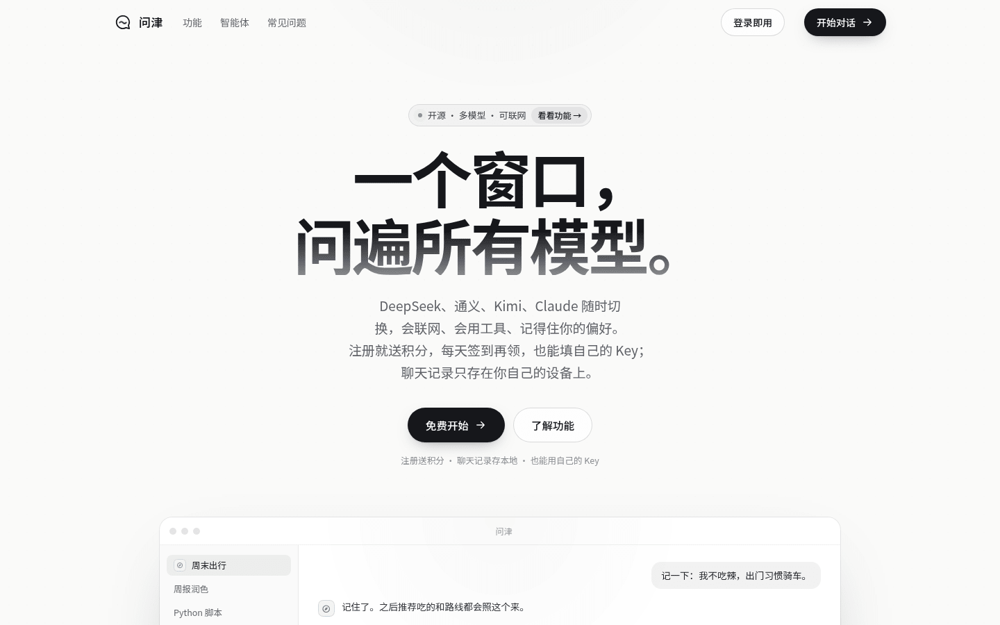
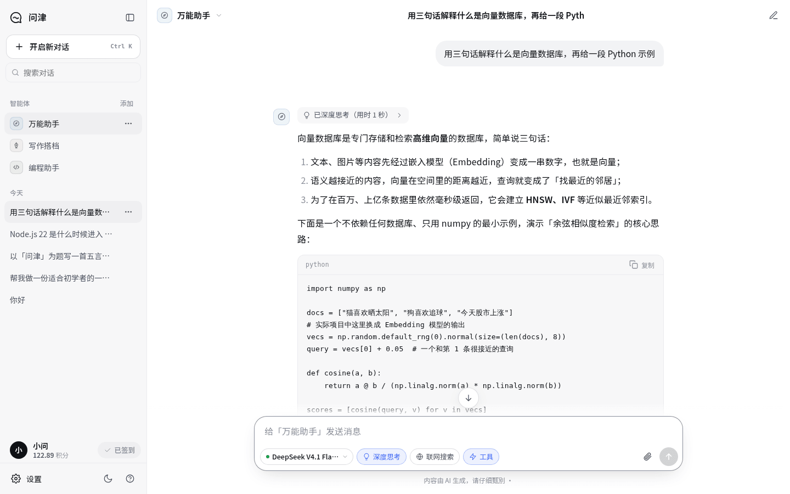
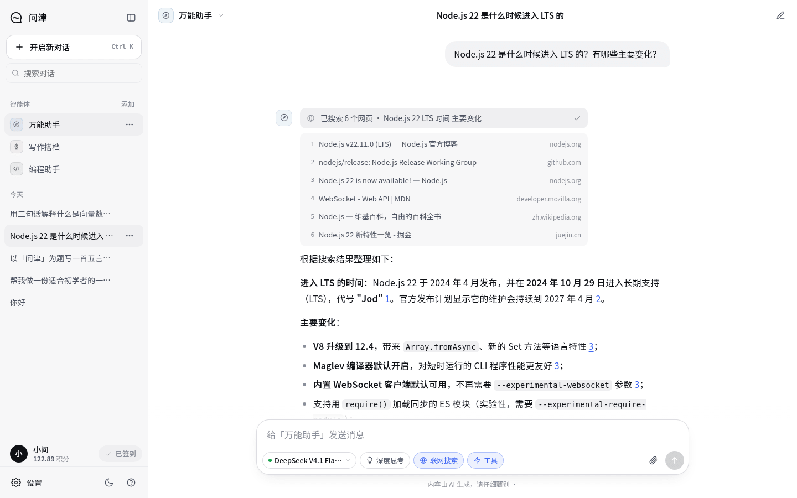
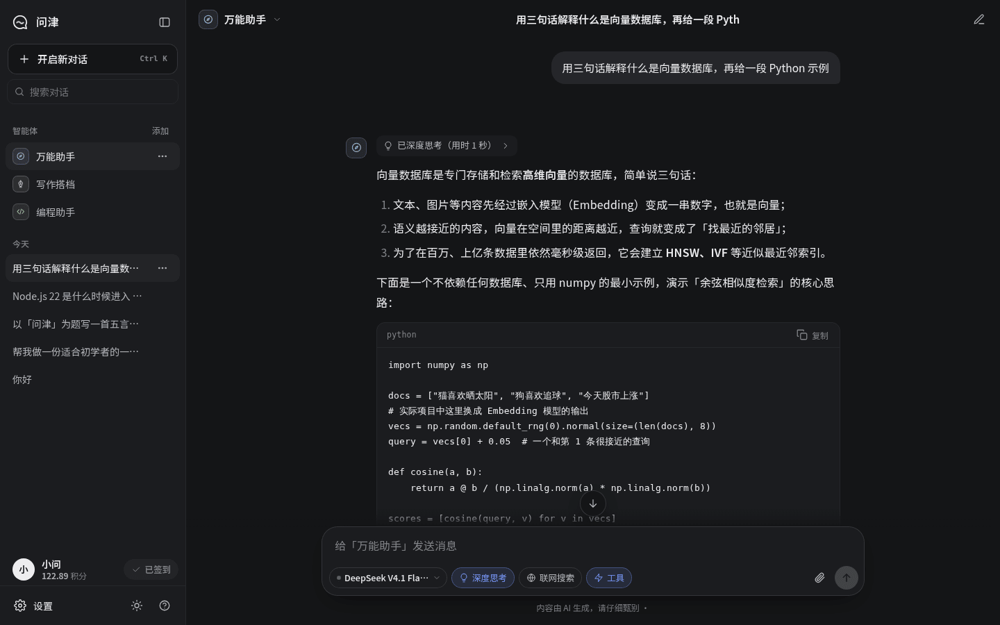
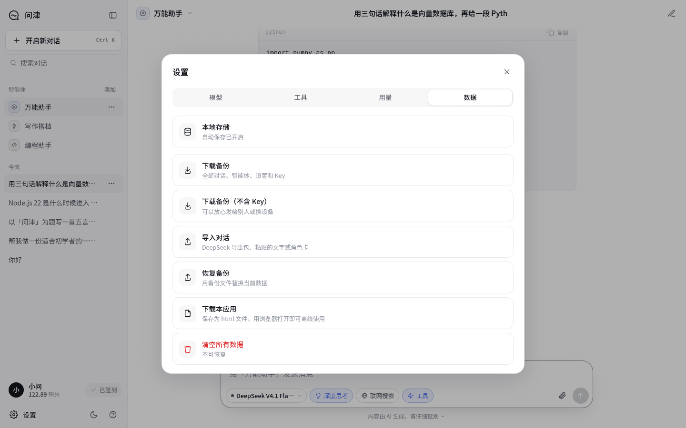
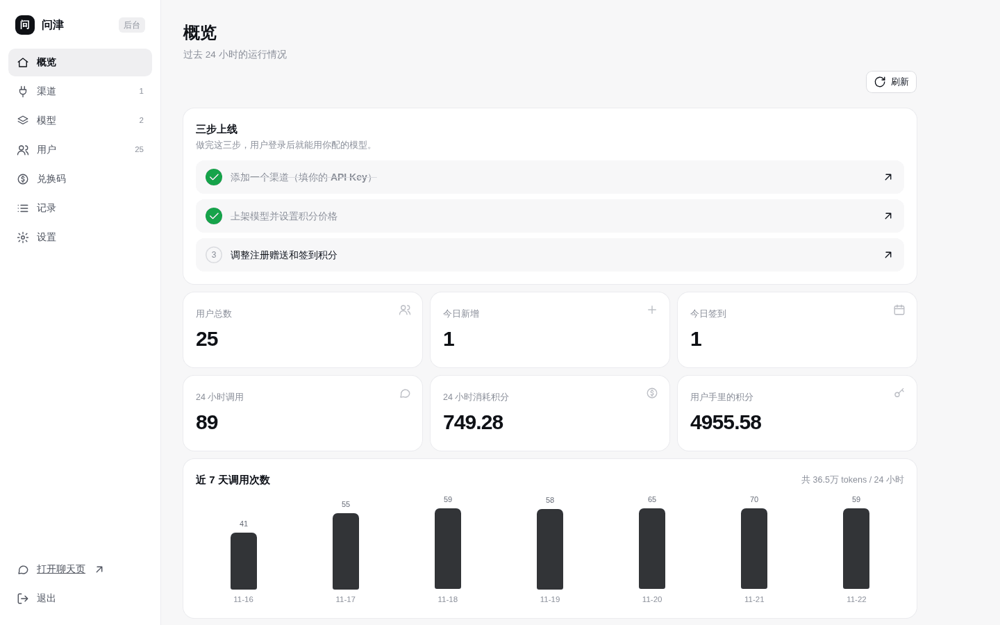
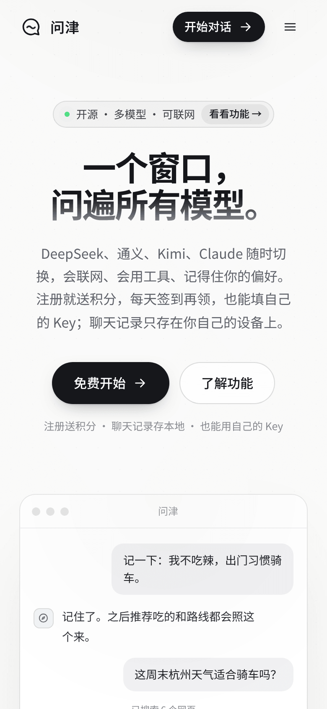
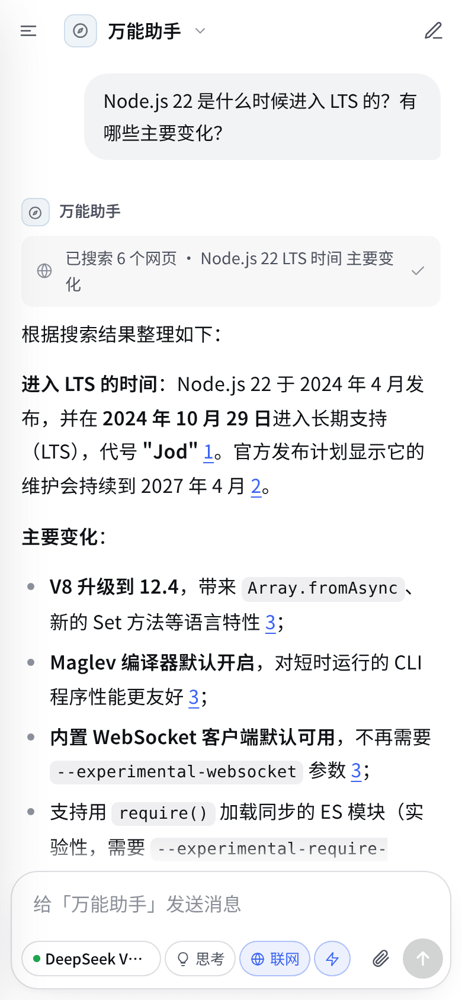

<div align="center">


<h1>问津 Wenjin</h1>

<p><b>一个窗口，问遍所有模型。</b><br>
可自托管的开源 AI 对话网站：多模型渠道、流式输出、联网搜索、积分体系与管理后台，<b>零 npm 依赖</b>，一条 <code>node server.js</code> 就能跑。</p>

<p>
<a href="LICENSE"></a>
<a href="https://nodejs.org/"></a>
<a href="#docker"></a>


</p>

<p><b>简体中文</b> · <a href="README.en.md">English</a></p>

<p>
<a href="#features">功能</a> ·
<a href="#quick-start">快速开始</a> ·
<a href="#deploy">部署</a> ·
<a href="#config">配置</a> ·
<a href="#faq">FAQ</a> ·
<a href="#security">安全</a>
</p>

</div>

---

问津（取自《论语》“使子路问津焉”，意为打听渡口）是一个可以自己部署的 AI 对话网站。管理员在后台接入任意 OpenAI 兼容的模型服务（DeepSeek、通义、Kimi、智谱、硅基流动、OpenRouter……），用户注册后用积分聊天；也可以不注册，直接在浏览器里填自己的 API Key 使用。**聊天记录只保存在用户自己的浏览器里**，服务器只负责转发和记录用量。

## 📸 截图

<table>
  <tr>
    <td width="50%"><p align="center"><sub>首页 · 桌面端</sub></p></td>
    <td width="50%"><p align="center"><sub>对话界面：深度思考、Markdown、代码块、表格（演示数据）</sub></p></td>
  </tr>
  <tr>
    <td><p align="center"><sub>联网搜索：「已搜索 N 个网页」来源面板与行内引用（演示数据）</sub></p></td>
    <td><p align="center"><sub>深色模式（演示数据）</sub></p></td>
  </tr>
  <tr>
    <td><p align="center"><sub>设置 → 数据：备份 / 恢复、导入 DeepSeek 导出包与角色卡</sub></p></td>
    <td><p align="center"><sub>管理后台 · 概览：用户、调用量、积分消耗、7 日趋势（演示数据）</sub></p></td>
  </tr>
  <tr>
    <td align="center"><p align="center"><sub>首页 · 手机端</sub></p></td>
    <td align="center"><p align="center"><sub>手机端对话，可添加到主屏幕（演示数据）</sub></p></td>
  </tr>
</table>

> 截图在本地实例上拍摄。标注「演示数据」的画面中，模型回答由本地 mock 的 OpenAI 兼容接口流式返回，搜索结果由 mock 的 SearXNG 接口返回，后台统计为虚构用户与调用记录，均不代表真实模型输出或真实用户。

<a name="features"></a>

## ✨ 功能一览

### 对话

| | |
| --- | --- |
| 🔌 **多模型渠道** | 后台接入任意 **OpenAI 兼容接口**（`/v1/chat/completions`），另有「DeepSeek 官方」类型支持思考模式开关；前端一键切换模型 |
| ⚡ **流式输出** | 服务端 SSE 逐块转发（关闭 Nagle、`X-Accel-Buffering: no`、15 秒心跳），前端自适应打字机效果，长回复也不卡 |
| 🧠 **深度思考** | 支持 `reasoning_content`，思考过程可折叠，显示思考用时 |
| 🌐 **联网搜索** | 自建 [SearXNG](https://github.com/searxng/searxng)，**所有模型**都能联网；回答附带「已搜索 N 个网页」来源面板和 `[编号](网址)` 行内引用；模型不支持工具调用时自动降级为「先搜再答」 |
| 🛠️ **工具调用（Agent）** | 读网页、运行 JavaScript 计算、生成文件、长期记忆、个人知识库、自定义 HTTP 工具 |
| 🔍 **对话搜索** | 按标题和内容搜索全部历史对话 |
| ✏️ **编辑后重发** | 编辑任意一条用户消息后重发，也可重新生成、复制、朗读 |
| 🗜️ **长对话自动压缩** | 接近上下文上限时自动生成「对话摘要」，原文保留，摘要可编辑 |
| 🎭 **智能体（人格）** | 内置万能助手、写作搭档、编程助手等模板；可设头像、性格、关系、开场白、禁用词，换模型也是同一个「它」 |
| 📥 **导入** | DeepSeek 官方导出包（zip / json）、粘贴的聊天文字、SillyTavern 角色卡（PNG / JSON） |
| 💾 **数据自主** | 对话存在浏览器 IndexedDB；一键备份 / 恢复、导出 Markdown、下载离线单文件版 |
| 📱 **PWA** | 带 Web App Manifest 与各尺寸图标，可在手机浏览器「添加到主屏幕」，全屏打开；浅色 / 深色主题跟随系统 |

### 账号与运营

| | |
| --- | --- |
| 👤 **账号** | 用户名或邮箱登录、找回密码、自托管 SVG 图形验证码（不依赖任何第三方验证服务） |
| ✉️ **邮箱验证** | 配置 SMTP 后，注册与找回密码走 6 位邮箱验证码（零依赖 SMTP 客户端，支持 465 SSL / STARTTLS） |
| 🪙 **积分体系** | 注册赠送、每日签到 + 连续签到加成、邀请码双方得积分、批量兑换码；按 token 计费，每条回复显示花费 |
| 🧭 **管理后台** | 概览统计、渠道（一键测试）、从渠道自动检测并上架模型、模型上下架与定价、用户管理、兑换码、站点设置、调用日志 |

### 安全

| | |
| --- | --- |
| 🔑 **Key 不出服务器** | 渠道 API Key 只存在服务端，任何接口都不会原样返回；上游报错中的 Key 与地址会被抹掉 |
| 🛡️ **SSRF 防护** | 读网页接口逐跳校验重定向，拦截内网 / 回环 / IPv4 映射地址，限制端口、大小与时长 |
| 🚦 **限流** | 登录、注册、验证码、对话、联网、兑换等接口按 IP / 账号限流；登录失败 3 次后要求图形验证码 |
| 🌍 **真实 IP** | `TRUST_PROXY` 正确识别反向代理 / Cloudflare 后的客户端 IP |

## 🧱 技术栈

- **后端**：纯 Node.js 标准库（`http`、`crypto`、`net`、`tls`……），`package.json` 里**没有任何 dependencies**，不需要 `npm install`。要求 Node.js ≥ 18（用到全局 `fetch`），推荐 22 LTS（Docker 镜像基于 `node:22-alpine`）。
- **前端**：原生 HTML / CSS / JavaScript，单文件 `public/index.html`（聊天）+ `public/admin.html`（后台），无构建步骤。
- **存储**：服务端一个 JSON 文件 `data/db.json`（原子写入）；用户对话存在浏览器 IndexedDB。
- **搜索**：可选的自建 SearXNG（`docker compose --profile search`）。

```
server.js          HTTP 服务、账号 / 积分 / 管理接口、模型转发（SSE）
websearch.js       SearXNG 客户端 + 防 SSRF 的网页正文读取
mailcap.js         零依赖 SMTP 发信 + SVG 图形验证码
public/            前端（index.html 聊天页、admin.html 管理后台、PWA manifest 与图标）
db.example.json    示例数据库（一个未启用的 DeepSeek 示例渠道，无用户、无 Key）
searxng/           SearXNG 示例配置
docs/              README 用到的横幅与截图
data/              运行时数据（已在 .gitignore 中忽略）
```

<a name="quick-start"></a>

## 🚀 快速开始

只需要 Node.js 18 或更新版本：

```bash
git clone https://github.com/jihemanyouzhe-boy/wenjin-chat.git && cd wenjin-chat
cp .env.example .env          # 编辑 .env，至少设置 ADMIN_PASSWORD（≥ 8 位）
node server.js                # 或 npm start
```

- 聊天页面：<http://localhost:3000>
- 管理后台：<http://localhost:3000/admin>

第一次启动会在 `data/db.json` 创建空数据库。也可以先拷贝示例数据库（带一个**未启用**的 DeepSeek 示例渠道和两个示例模型，没有任何 Key），然后在后台填入自己的 Key 并启用：

```bash
mkdir -p data && cp db.example.json data/db.json
```

<a name="deploy"></a>

## 📦 详细部署

下面以域名 `chat.example.com`、安装目录 `/opt/wenjin-chat` 为例，请替换成你自己的。

### (a) 直接用 Node + systemd

```bash
# 1. 安装 Node.js 22（任选一种方式，例如 NodeSource / nvm / 发行版仓库）
node -v    # 确认 ≥ 18

# 2. 拉取代码，建专用用户
sudo git clone https://github.com/jihemanyouzhe-boy/wenjin-chat.git /opt/wenjin-chat
sudo useradd --system --home /opt/wenjin-chat --shell /usr/sbin/nologin wenjin
cd /opt/wenjin-chat
sudo cp .env.example .env
sudo nano .env      # 设置 ADMIN_PASSWORD；放在反向代理后面时设 HOST=127.0.0.1、TRUST_PROXY=1
sudo mkdir -p data && sudo chown -R wenjin:wenjin data
sudo chown wenjin:wenjin .env && sudo chmod 600 .env
```

`server.js` 启动时会自动读取同目录下的 `.env`（已存在的环境变量优先），所以 unit 文件里不需要再写 `EnvironmentFile`。

`/etc/systemd/system/wenjin.service`：

```ini
[Unit]
Description=Wenjin AI chat
After=network-online.target
Wants=network-online.target

[Service]
Type=simple
User=wenjin
Group=wenjin
WorkingDirectory=/opt/wenjin-chat
ExecStart=/usr/bin/node /opt/wenjin-chat/server.js
Restart=on-failure
RestartSec=3
# 收到 SIGTERM 时会先把数据库写盘再退出
KillSignal=SIGTERM
TimeoutStopSec=10

# 加固（可选）
NoNewPrivileges=true
PrivateTmp=true
ProtectSystem=strict
ProtectHome=true
ReadWritePaths=/opt/wenjin-chat/data

[Install]
WantedBy=multi-user.target
```

```bash
sudo systemctl daemon-reload
sudo systemctl enable --now wenjin
journalctl -u wenjin -f        # 看日志
```

> `which node` 不是 `/usr/bin/node`（比如用 nvm 安装）时，把 `ExecStart` 改成实际路径。

<a name="docker"></a>

### (b) Docker / docker compose

仓库自带 `Dockerfile`（`node:22-alpine`，以非 root 的 `node` 用户运行，带健康检查）和 `docker-compose.yml`：

```bash
cp .env.example .env
# 编辑 .env：设置 ADMIN_PASSWORD；要用联网搜索再加一行 SEARXNG_SECRET=$(openssl rand -hex 32) 的结果
mkdir -p data && sudo chown -R 1000:1000 data   # 容器内 node 用户的 uid 是 1000

docker compose up -d                       # 只启动聊天服务
docker compose --profile search up -d      # 同时启动自建 SearXNG（联网搜索）
docker compose logs -f wenjin
```

- 数据保存在宿主机 `./data`（挂载到容器 `/app/data`）。
- 启用 `search` profile 后，SearXNG 只在 Docker 内部网络中可见（不映射端口），聊天服务通过 `http://searxng:8080` 访问它。这个地址由 compose 里的 `SEARXNG_URL`（可用 `SEARXNG_URL_DOCKER` 覆盖）在**首次建库**时写入。
- SearXNG 配置在 `searxng/settings.yml`，必须保留 `search.formats: [html, json]`；服务器在中国大陆时，文件里有可用引擎的说明。
- 前面有 Nginx / Caddy 时，把端口映射改成 `"127.0.0.1:3000:3000"`，并在 `.env` 里设置 `TRUST_PROXY=1`。

### (c) 反向代理

问津的回复是 **SSE 流式输出**，反向代理必须关闭响应缓冲，否则会出现「等很久然后一次性吐出全部内容」。另外长对话会把完整历史发给服务器（服务端上限 40 MB），记得调大请求体限制。

**Nginx**（`/etc/nginx/conf.d/wenjin.conf`）：

```nginx
server {
    listen 80;
    server_name chat.example.com;

    client_max_body_size 50m;            # 长对话请求体较大

    location / {
        proxy_pass http://127.0.0.1:3000;
        proxy_http_version 1.1;
        proxy_set_header Host $host;
        proxy_set_header X-Real-IP $remote_addr;
        proxy_set_header X-Forwarded-For $proxy_add_x_forwarded_for;
        proxy_set_header X-Forwarded-Proto $scheme;
        proxy_set_header Connection "";

        # 流式输出关键设置
        proxy_buffering off;
        proxy_cache off;
        gzip off;
        proxy_read_timeout 600s;
        proxy_send_timeout 600s;
    }
}
```

**Caddy**（`/etc/caddy/Caddyfile`，自动申请 HTTPS 证书）：

```caddy
chat.example.com {
    request_body {
        max_size 50MB
    }
    reverse_proxy 127.0.0.1:3000 {
        flush_interval -1        # 立即转发每个数据块（SSE）
    }
}
```

两种方式都要在 `.env` 里设置 `HOST=127.0.0.1`（或 Docker 映射到 `127.0.0.1:3000`）和 `TRUST_PROXY=1`，然后重启服务。

### (d) Cloudflare Tunnel（无公网 IP / 不开放端口）

```bash
# 1. 安装 cloudflared（见 Cloudflare 官方文档），登录并授权你的域名
cloudflared tunnel login

# 2. 创建隧道，记下输出的 Tunnel ID
cloudflared tunnel create wenjin

# 3. 把子域名指向这条隧道
cloudflared tunnel route dns wenjin chat.example.com
```

`~/.cloudflared/config.yml`：

```yaml
tunnel: <TUNNEL_ID>
credentials-file: /home/<user>/.cloudflared/<TUNNEL_ID>.json

ingress:
  - hostname: chat.example.com
    service: http://127.0.0.1:3000
  - service: http_status:404
```

```bash
cloudflared tunnel run wenjin                 # 前台试运行
sudo cloudflared service install              # 确认无误后装成系统服务
```

`.env` 中设置 `HOST=127.0.0.1`，并且因为服务只能经 Cloudflare 访问，可以设置 `TRUST_PROXY=cloudflare`（优先使用 `CF-Connecting-IP`）。也可以在 Cloudflare Zero Trust 控制台里用「远程管理隧道」完成同样的配置。

### (e) HTTPS

- **Caddy**：写上域名即可自动申请并续期 Let's Encrypt 证书，无需额外操作。
- **Nginx**：用 certbot：
  ```bash
  sudo apt install certbot python3-certbot-nginx
  sudo certbot --nginx -d chat.example.com
  ```
- **Cloudflare Tunnel**：边缘自动提供 HTTPS，源站走隧道，无需证书。

PWA「添加到主屏幕」和剪贴板等浏览器能力需要 HTTPS（`localhost` 除外）。

### (f) 上线后的配置

**1. 管理员账号**

- 推荐：启动前在 `.env` 里设置 `ADMIN_PASSWORD`（≥ 8 位）。它**只在数据库里还没有管理员时生效**，之后修改请到后台「设置 → 安全」。
- 没设置时，第一个打开 `/admin` 的人可以设置管理员密码，所以请尽快完成这一步。

**2. 添加渠道（以 DeepSeek 为例）**

1. 后台 → **渠道** → 添加渠道：
   - 名称：`DeepSeek`
   - 类型：`DeepSeek 官方`（支持思考模式开关）；其他服务商选 `OpenAI 兼容`
   - 接口地址：`https://api.deepseek.com`（OpenAI 兼容服务一般填到 `/v1`，例如 `https://api.openai.com/v1`；误贴 `/chat/completions`、`/responses`、`/models` 结尾会自动截掉）
   - API Key：你在服务商控制台创建的 Key
2. 点渠道右侧的 **测试** 确认连通。
3. 后台 → **模型** → **上架模型**：会自动从渠道检测可用模型，勾选后「上架所选」；再按需修改对外名称、上游模型名（以服务商文档为准）、上下文长度、输入 / 输出价格（积分 / 千 token）、是否支持思考。

**3. 发信邮箱（SMTP，可选）**

两种方式二选一：

- 在 `.env` 中填写 `SMTP_HOST`、`SMTP_PORT`、`SMTP_USER`、`SMTP_PASS`、`SMTP_FROM_NAME`。`SMTP_USER` 和 `SMTP_PASS` 都填时优先使用环境变量，后台的发信设置变为只读。
- 或在后台「设置 → 邮箱验证」里填写，然后发一封「测试邮件」确认能收到。

端口 `465` 走 SSL，其他端口走 STARTTLS。QQ / 163 等邮箱的密码通常是 SMTP「授权码」而不是登录密码。配置好之后，「注册需要邮箱验证码」开关（默认开启）才会真正生效；没配置邮箱时，注册使用图形验证码。

**4. 开启联网搜索**

1. 部署 SearXNG：Docker 用户直接 `docker compose --profile search up -d`；裸机部署可以单独跑一个只监听本机的实例：
   ```bash
   docker run -d --name wenjin-searxng --restart unless-stopped \
     -p 127.0.0.1:8890:8080 \
     -v "$(pwd)/searxng:/etc/searxng" \
     -e SEARXNG_SECRET="$(openssl rand -hex 32)" \
     searxng/searxng:latest
   ```
2. 后台 → **设置 → 联网搜索**：打开开关，地址填 `http://searxng:8080`（compose）或 `http://127.0.0.1:8890`（上面的单独实例），点「测试搜索」。
3. 用户登录后，在输入框下方打开「联网搜索」即可。

<a name="config"></a>

## ⚙️ 配置项

所有配置来自环境变量，或项目目录下的 `.env` 文件（已存在的环境变量优先）。示例见 [`.env.example`](.env.example)。

| 变量 | 默认值 | 说明 |
| --- | --- | --- |
| `PORT` | `3000` | 监听端口 |
| `HOST` | `0.0.0.0` | 监听地址；只给本机反向代理用时写 `127.0.0.1` |
| `DATA_DIR` | `./data` | 数据目录（相对路径相对于 `server.js` 所在目录）；`db.json` 包含用户、会话和渠道 Key |
| `SITE_NAME` | `问津` | 站点名称，仅首次建库时使用，之后在后台修改；也是发信人名称的兜底值 |
| `ADMIN_PASSWORD` | 空 | 管理员密码（建议 ≥ 8 位），**仅在还没有管理员时生效**。强烈建议设置 |
| `TRUST_PROXY` | `0` | `0` 直连，用 TCP 来源地址；`1` 前面有一层反向代理，取 `X-Forwarded-For` 最后一项；`cloudflare` 优先 `CF-Connecting-IP`（仅当只能经 Cloudflare 访问时） |
| `SEARXNG_URL` | `http://127.0.0.1:8890` | SearXNG 地址（也接受旧名 `SEARCH_URL`），仅首次建库时作为默认值，之后在后台「设置 → 联网搜索」修改 |
| `SMTP_HOST` | `smtp.qq.com` | 发信服务器 |
| `SMTP_PORT` | `465` | 端口：`465` = SSL，其他走 STARTTLS |
| `SMTP_USER` | 空 | 发信邮箱 |
| `SMTP_PASS` | 空 | 邮箱密码 / 授权码；与 `SMTP_USER` 都填时优先于后台设置 |
| `SMTP_FROM_NAME` | 站点名 | 发件人名称 |
| `CAPTCHA_TEST` | 关闭 | 仅本地自动化测试：为 `1` 时图形验证码接口会返回答案。**生产环境不要开启** |

仅 `docker-compose.yml` 使用的变量：

| 变量 | 默认值 | 说明 |
| --- | --- | --- |
| `SEARXNG_SECRET` | `change-me-to-a-random-string` | SearXNG 的密钥，请改成 `openssl rand -hex 32` 的结果 |
| `SEARXNG_URL_DOCKER` | `http://searxng:8080` | 容器内聊天服务访问 SearXNG 的地址（写入容器的 `SEARXNG_URL`） |

> 站点名称、公告、注册开关、邮箱验证、积分规则、并发限制、联网开关与地址等运营参数都在后台「设置」中修改，保存在 `db.json`，不需要重启。

## 💾 数据与备份

| 位置 | 内容 |
| --- | --- |
| 服务器 `data/db.json` | 站点设置、渠道与 **API Key**、模型、用户（密码为 scrypt 哈希）、会话、兑换码、调用日志 |
| 用户浏览器 IndexedDB | 对话、智能体、长期记忆、知识库、用户自己填的 Key |

服务端不保存聊天内容。备份只需要复制 `data/db.json`（写入是原子替换，直接复制是安全的）：

```bash
# 每天 03:00 备份一次，保留 14 天（crontab -e）
0 3 * * * cp /opt/wenjin-chat/data/db.json /var/backups/wenjin-$(date +\%F).json && find /var/backups -name 'wenjin-*.json' -mtime +14 -delete
```

请把备份文件权限设为仅自己可读（里面有渠道 Key）。用户的对话请提醒他们在「设置 → 数据 → 下载备份」自行备份或换设备恢复。

## ⬆️ 升级

```bash
# 裸机
cd /opt/wenjin-chat
cp data/db.json data/db.json.bak-$(date +%F)    # 先备份
git pull
sudo systemctl restart wenjin

# Docker
git pull
docker compose up -d --build                    # 用了搜索时加 --profile search
```

数据库结构向后兼容：启动时会为旧数据库自动补齐新增的设置项。

<a name="faq"></a>

## ❓ 常见问题

<details>
<summary><b>回复不是一个字一个字出来，而是等很久后一次性显示</b></summary>

反向代理在缓冲响应。Nginx 加 `proxy_buffering off;`（并关闭该 location 的 `gzip`），Caddy 加 `flush_interval -1`。如果中间还有 CDN，确认它没有对 `text/event-stream` 做缓冲或压缩。服务器本身已发送 `X-Accel-Buffering: no` 和每 15 秒一次的心跳。
</details>

<details>
<summary><b>打开联网搜索后提示「联网搜索需要先登录账号」</b></summary>

这是有意的设计：搜索和读网页接口只对登录用户开放，并按账号和 IP 限流，防止站点被当成匿名搜索 / 抓取代理。只在浏览器里填自己 Key、未登录的访客不能使用联网搜索。如果登录后仍失败，到后台「设置 → 联网搜索」点「测试搜索」，检查 SearXNG 地址，以及 `settings.yml` 中是否开启了 `json` 格式。
</details>

<details>
<summary><b>添加渠道后测试失败，或服务商提示只支持 <code>/responses</code></b></summary>

问津调用的是标准的 `POST {接口地址}/chat/completions`。接口地址只需要填到 `/v1` 这一级（DeepSeek 官方为 `https://api.deepseek.com`），误贴的 `/chat/completions`、`/responses`、`/models` 会自动截掉。只开放 Responses API、或只允许特定官方客户端 / 编程工具调用的服务商无法直接接入，可以换成提供 Chat Completions 接口的服务商或兼容网关。
</details>

<details>
<summary><b>请求报 413 / 长对话发不出去</b></summary>

反向代理的请求体上限太小。Nginx 设 `client_max_body_size 50m;`，Caddy 设 `request_body { max_size 50MB }`。
</details>

<details>
<summary><b>Docker 启动后报 EACCES，无法写入 <code>/app/data</code></b></summary>

容器以 uid 1000 的 `node` 用户运行。执行 `sudo chown -R 1000:1000 data` 后重启容器。
</details>

<details>
<summary><b>限流、登录保护对所有人生效 / 日志里的 IP 都是 127.0.0.1</b></summary>

服务在反向代理后面但没有设置 `TRUST_PROXY`。设置为 `1`（Nginx / Caddy）或 `cloudflare`（只经 Cloudflare 访问）后重启。反过来，直接对外提供服务时请保持 `0`，否则客户端可以伪造来源 IP。
</details>

<details>
<summary><b>忘记管理员密码</b></summary>

停止服务，编辑 `data/db.json` 把 `"admin"` 的值改成 `null`，然后在 `.env` 里设置新的 `ADMIN_PASSWORD` 并启动服务。
</details>

<details>
<summary><b>收不到邮箱验证码</b></summary>

在后台「设置 → 邮箱验证」发一封「测试邮件」查看报错。常见原因：用了登录密码而不是授权码、云服务器封禁了 25 / 465 端口出站、发件邮箱未开启 SMTP 服务。
</details>

<a name="security"></a>

## 🔒 安全说明

- **一定要设置 `ADMIN_PASSWORD`**（或部署后立即打开 `/admin` 设置密码）。
- `data/db.json` 含有渠道 API Key 和用户密码哈希：`chmod 600`，不要提交到 Git（已在 `.gitignore` 中），备份同样要保护好。
- 反向代理后面才设置 `TRUST_PROXY`；直连时保持 `0`。
- 绑定 `HOST=127.0.0.1`，只让反向代理 / 隧道访问 Node 端口。
- SearXNG 不要暴露到公网；`SEARXNG_SECRET` 使用随机值。
- 生产环境不要设置 `CAPTCHA_TEST=1`。
- 内置防护：Key 永不返回前端且会从上游报错中抹除；读网页接口防 SSRF（只允许 80 / 443 / 8080 / 8443 端口，DNS 解析后拦截私网地址，逐跳校验最多 4 次重定向，2 MB / 8 秒上限）；密码使用 scrypt；登录、注册、验证码、对话、联网、兑换、管理员登录均有限流。

发现安全问题？请按 [SECURITY.md](SECURITY.md) 私下报告，不要公开提交 issue。

## 🤝 参与贡献

欢迎 issue 和 PR！开始之前请阅读 [CONTRIBUTING.md](CONTRIBUTING.md)。项目坚持零依赖、无构建步骤，提交前请运行 `npm run check`。版本变化见 [CHANGELOG.md](CHANGELOG.md)。

## 🙏 致谢

- [SearXNG](https://github.com/searxng/searxng) — 自托管、尊重隐私的元搜索引擎，为问津的联网搜索提供结果。
- [shields.io](https://shields.io) — README 徽章。
- 横幅题字使用 [Ma Shan Zheng（马善政楷书）](https://fonts.google.com/specimen/Ma+Shan+Zheng) 与 [Noto Serif SC](https://fonts.google.com/noto/specimen/Noto+Serif+SC)，均为 SIL Open Font License。
- 所有提供 OpenAI 兼容接口的模型服务商与开源社区。

## ⭐ Star History

<a href="https://star-history.com/#jihemanyouzhe-boy/wenjin-chat&Date">
  
</a>

## 📄 许可证

[MIT](LICENSE) © 2026 几何漫游者
